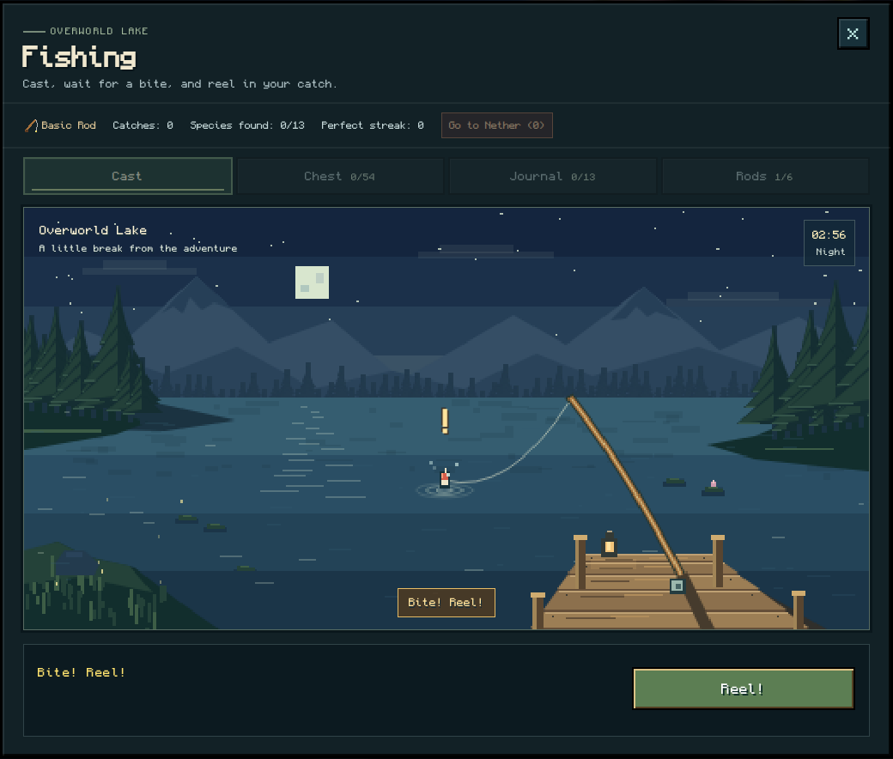
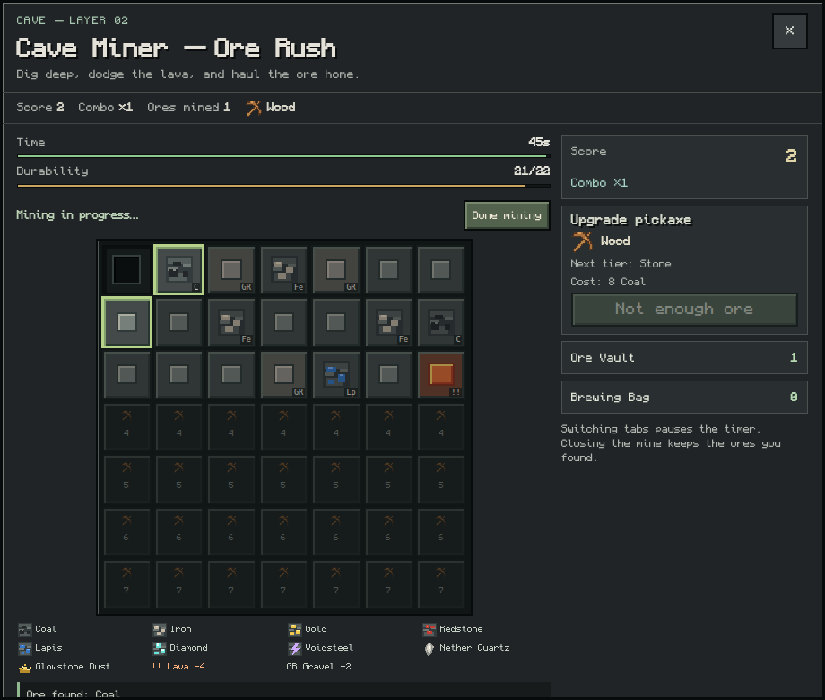
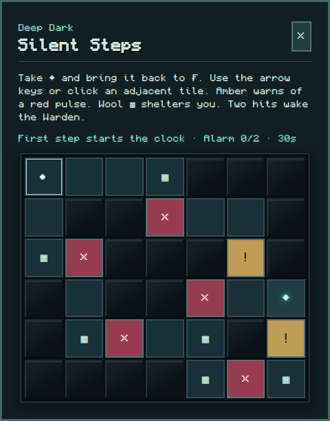
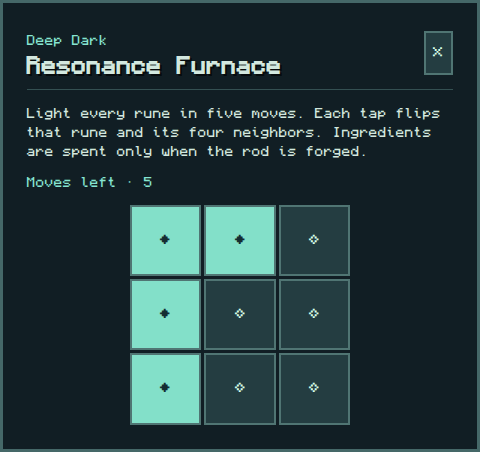
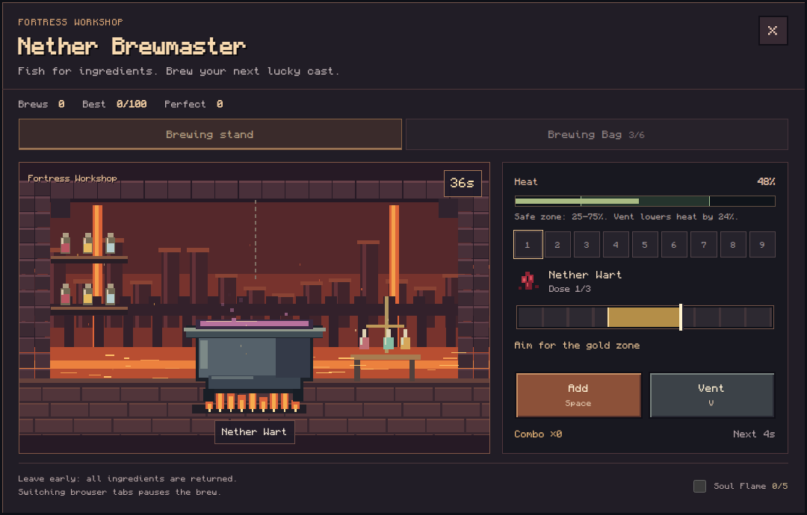
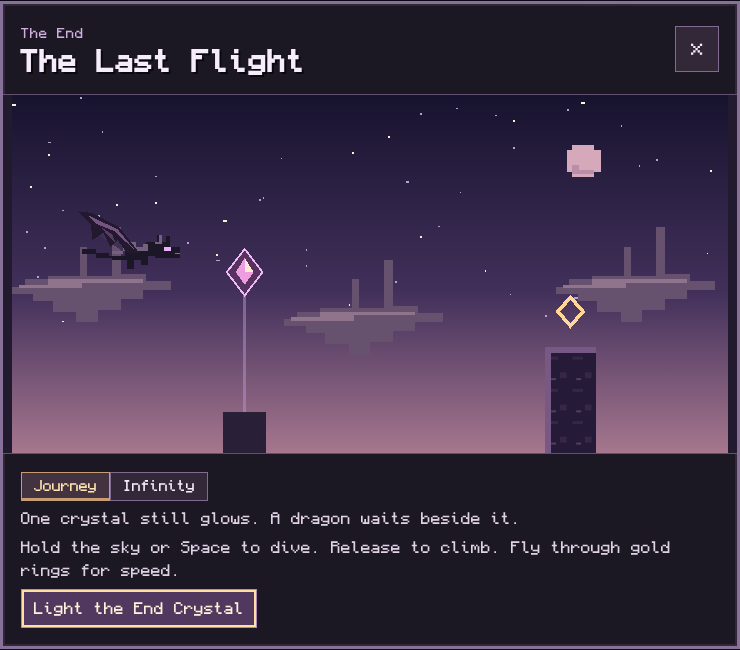
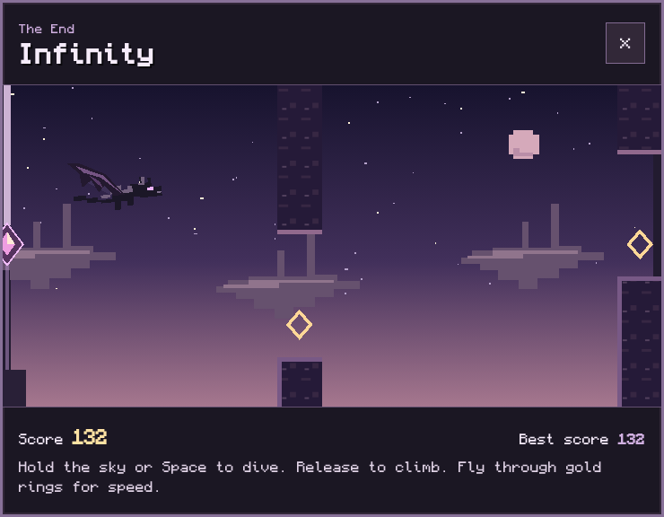
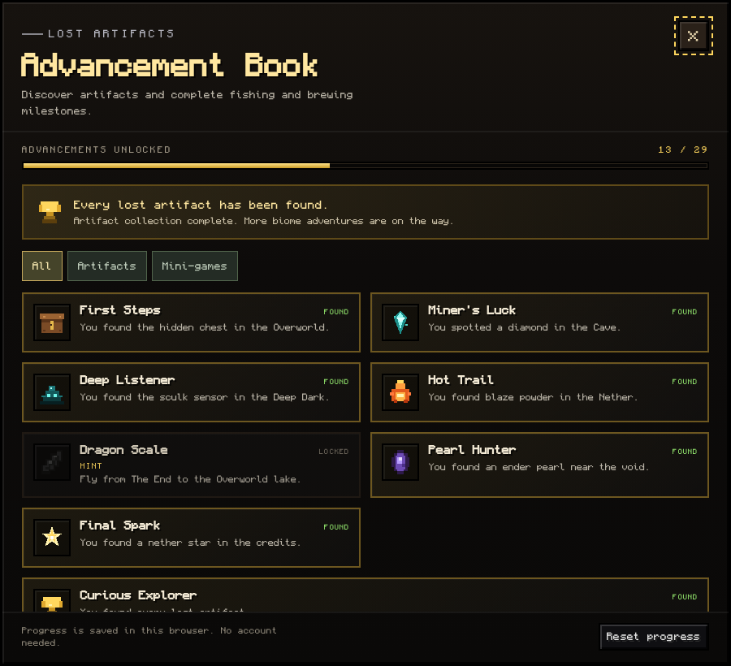

# Portfolio — A Minecraft Journey

A personal portfolio website with a Minecraft theme. Biome-based scroll snapping, a
"Loading world" style loading screen, bilingual (EN/ID), and an admin panel to edit
content without code.

[Minigames](#minigames) · [Achievement Book](#achievement-book) · [Run locally](#running-locally) · [Deployment](#deploy)

## Sections

| # | Biome | Content |
|---|---|---|
| 01 | Overworld | Introduction, name, photo, about me |
| 02 | Cave | Education, skills (ore tiers) |
| 03 | Deep Dark | Projects & achievements |
| 04 | Nether | Organizations & experiences |
| 05 | The End | Contact & social media |
| 06 | Credits | Closing credits |

## Stack

- Vite + React + TypeScript
- Supabase (Postgres, Auth, Storage)
- TanStack Query
- Plain CSS (no UI framework)
- Deploy: Vercel / Netlify

## Running locally

```bash
npm install
npm run dev
```

Open http://localhost:5173

### Environment

Create `.env.local`:

```
VITE_SUPABASE_URL=https://xxxxx.supabase.co
VITE_SUPABASE_ANON_KEY=your-publishable-or-anon-key
```

Without the env vars, the site still runs using fallback content (admin login
will not work).

## Supabase setup

1. Create a project (Singapore region).
2. **Settings → API**: note the Project URL + anon/publishable key.
3. **Authentication → Sign In / Providers → Email**: disable **Enable Sign Ups**.
4. **Authentication → Users → Add user**: create an admin, check **Auto Confirm User**.
5. **Storage → New bucket**: name it `media`, set it to **Public**.
6. **SQL Editor** → paste the contents of `supabase/migrations/0001_init.sql` → **Run**.
7. Run `supabase/migrations/0002_achievements.sql` if it has not been applied yet.
8. From the SQL Editor, assign admin based on the **User UID** you verified in Authentication. Replace the placeholder with your account's UUID, make sure exactly one row is updated, then sign out and sign in again so the token refreshes.

```sql
update auth.users
set raw_app_meta_data = coalesce(raw_app_meta_data, '{}'::jsonb) || '{"portfolio_admin":true}'::jsonb
where id = '<ADMIN_USER_UUID>'::uuid
returning id;
```

9. Apply the [access restriction migration](supabase/migrations/20261126050913_restrict_portfolio_access.sql) in the SQL Editor. Then deploy the matching frontend. For login protection, check Supabase Auth rate limits and enable leaked password rejection if it is available on the project plan.

Migration `0001` creates the tables, RLS policies, storage policies, and starter content
(3 projects, 8 skills, 3 experiences, 4 socials). `0002` adds the
`achievements` table for competition certificates. The last migration restricts content
changes, draft reads, and media uploads to the admin. Files in the public bucket can be
accessed via URL, including images used in drafts.

## Admin

- URL: `/admin`
- Log in with the account created in Supabase Auth.
- Tabs: Profile, Projects, Achievements, Skills, Experience, Socials, Settings.
- Every text field has an **EN** and an **ID** tab.
- Upload images directly from the browser; they are compressed to WebP (max 1600px) before
  reaching Supabase Storage.
- Changes appear on the site immediately (no rebuild).

Note: Deep Dark shows **all published projects** in a horizontal row — 3 visible
at once on desktop, the rest paged with the ←/→ buttons or by swiping. **3 achievements
per page** (←/→ buttons if there are more than 3).
Use the ↑/↓ buttons to reorder. Certificates are uploaded via
**Admin → Achievements → Certificate image**.

## Structure

```
src/
├── main.tsx / App.tsx / Portfolio.tsx
├── data/           # types, fetch, fallback, sections
├── i18n/           # EN/ID dictionary + LanguageProvider
├── components/     # loading, hotbar, music, toast, icons
├── sections/       # Overworld, Cave, DeepDark, Nether, TheEnd, Credits
├── admin/          # login, dashboard, editors, form components
├── styles/         # site, minigame, and admin styles
└── lib/            # game rules, saves, achievements, and Supabase client

public/
├── fonts/          # Monocraft (SIL OFL)
├── textures/       # generated 16×16 textures
├── img/biomes/     # AVIF + WebP backgrounds (1280/1920/2560)
└── audio/          # music (tracked in Git)

docs/screenshots/   # gameplay and Achievement Book screenshots
```

## Minigames

Open the game icon next to the Achievement Book while you are in its biome. The bottom hotbar is for biome navigation. On desktop, use the arrow keys or `1`–`6` to move between sections and `Esc` to close a game. On a phone, tap a hotbar slot and then the game icon.

| Biome | Minigame | Open | Phone controls |
| --- | --- | --- | --- |
| Overworld | [Fishing](#fishing--overworld) | `F` | Tap **Cast**, then hold and release **Reel** |
| Cave | [Cave Miner — Ore Rush](#cave-miner--ore-rush) | `C` | Tap reachable blocks; switch between Mine and Gear |
| Deep Dark | [Silent Steps](#silent-steps--deep-dark) | `D` → **Silent Steps** | Swipe the board or tap a neighboring tile |
| Deep Dark | [Resonance Furnace](#resonance-furnace--deep-dark) | `D` → light the furnace | Tap runes to flip them |
| Nether | [Nether Brewmaster](#nether-brewmaster) | `N` | Tap **Add** and **Vent heat** |
| The End | [The Last Flight](#the-last-flight--the-end) | `L` | Hold the sky or **Hold to dive**; release to climb |

Fishing and mining stock the shared Brewing Bag. Brewing can boost fishing or supply a potion for the furnace, where the Echo Shard and Voidsteel help forge the rod that attracts the Echo Fish.

### Fishing — Overworld



Cast, wait for the `!` signal, and reel the fish in. Hold to bring it closer and release to lower tension before the line snaps. The lake changes between night, dawn, day, and dusk using the device's local time.

- **Journal** tracks 12 regular species plus the secret **Echo Fish**, including catch counts, best length, and best weight.
- **Chest** stores up to 54 fish. It can be sorted by newest or heaviest, and fish can be released with confirmation.
- **Rods** lets you equip Basic, Sturdy, Lucky, Golden, Prismarine, or the forged Warden Rod. Regular upgrades come from fishing milestones.
- A **Rift catch** can replace a fish with a brewing material. The base chance is 14%, with bonuses from rod luck and Ember Bait. Materials go to the shared **Brewing Bag**.
- The first five Warden Rod casts have a 20%, 40%, 60%, 80%, and 100% chance of an Echo Fish bite, respectively. From the fifth cast onward, the bite is guaranteed until you land the fish.

### Cave Miner — Ore Rush



Pick a route across a fresh **7 × 7** board. Start on the top row, then dig only into blocks next to ones you have already mined. Deeper rows and consecutive ore or material finds raise the score. Stone, gravel, and lava break the combo. Most blocks cost 1 durability, gravel costs 2, and lava costs 4.

A run lasts up to **45 seconds**. Use **Done mining** to bank your score once you have dug at least one block. Ores go to the **Ore Vault** as you mine them. Quartz (rows 4–7) and Glowstone Dust (rows 6–7) go to the Brewing Bag. **Voidsteel** has a 5% chance per block in row 7 and is used in the furnace.

| Pickaxe | Reach | Durability | Upgrade cost |
| --- | --- | --- | --- |
| Wood | Rows 1–3 | 22 | Starting pickaxe |
| Stone | Rows 1–4 | 27 | 8 Coal |
| Iron | Rows 1–6 | 32 | 8 Iron + 16 Coal |
| Diamond | Rows 1–7 | 38 | 2 Diamond + 10 Iron + 16 Coal |

### Silent Steps — Deep Dark



Bring the **Echo Shard** (◆) back to the entrance (⚑) within **30 seconds**. The first step starts the timer. Move one tile per beat using the arrow keys, by clicking an adjacent tile, or with the phone controls. Amber warns of an incoming red pulse, and wool tiles give you a safe place to wait. Two hits wake the Warden. Retry until you bring the shard back.

### Resonance Furnace — Deep Dark



Forge the **Warden Rod** once you have the Echo Shard, one Voidsteel, one Potion of Resonance, and all six hidden artifacts. Enable **Soul Flame** in Nether Brewmaster to light the furnace.

Light all nine runes in **five moves or fewer**. Each press flips the selected rune and its neighbors directly above, below, to the left, and to the right. A failed attempt keeps your ingredients. Forging spends the Voidsteel and potion. Equip the finished rod in the Overworld's **Rods** tab.

### Nether Brewmaster



Catch Rift materials in the Overworld or mine Quartz and Glowstone Dust in Cave. The six materials are Nether Wart, Glowstone Dust, Nether Quartz, Magma Cream, Blaze Powder, and Ghast Tear. Claim the one-time starter kit to try the first recipe.

Each **36-second** round uses three ingredients and gives you nine pours. Press **Add** (`Space`) when the marker enters the gold zone. Use **Vent heat** (`V`) to keep heat in the 25–75% safe zone. Precision and time spent at a safe temperature raise the score. Closing an unfinished brew or finishing with Failed quality refunds all three ingredients. Clumsy refunds the first ingredient.

| Recipe | Unlocks after | Reward at Good quality |
| --- | --- | --- |
| Experience | Available at start | Ember Bait for 5 casts |
| Fire Resistance | 1 completed round | Ember Bait for 8 casts |
| Strength | 3 completed rounds | Potion of Luck for 5 casts |
| Luck | 5 completed rounds | Potion of Luck for 8 casts |
| Resonance | 8 completed rounds | 1 Potion of Resonance for the furnace |

Ember Bait improves material odds, and Potion of Luck improves fish rarity rolls. Both apply automatically and are consumed when a cast starts. A Perfect brew adds a Nether Ember and extends any fishing bonus reward by two casts. Five Perfect brews unlock the **Soul Flame** toggle below the brewing panel.

### The Last Flight — The End



Hold the sky or `Space` to dive and release to climb. Fly between the pillars and pass through gold rings for a two-second tailwind.

- **Journey** has three legs and nine pillar gaps. If you hit a pillar, the dragon carries you back to the last checkpoint. Reaching the Overworld lake unlocks the **Dragon Scale** keepsake in the book.
- **Infinity** has one life. The gaps alternate high and low, get narrower, and come faster as you progress. Your score is distance + 200 per cleared gap + 350 per ring. The browser saves your best score.

<details>
<summary>Infinity mode screenshot</summary>



</details>

## Achievement Book



Open the book icon at the top or press `E`. The **29 achievements** can be browsed under **All**, **Artifacts**, or **Minigame**. The Deep Dark section's portfolio achievements and certificates are a separate collection managed through the admin panel.

<details>
<summary>Full achievement checklist (includes game spoilers)</summary>

| Group | Achievement | How to unlock |
| --- | --- | --- |
| Artifact | First Steps | Find the Overworld chest |
| Artifact | Miner's Luck | Find the Cave diamond artifact |
| Artifact | Deep Listener | Find the Deep Dark sculk sensor |
| Artifact | Hot Trail | Find the Nether blaze powder artifact |
| Artifact | Pearl Hunter | Find the ender pearl in The End |
| Artifact | Final Spark | Find the nether star in Credits |
| Exploration | Curious Explorer | Find all six hidden artifacts |
| Fishing | First Catch | Catch your first fish |
| Fishing | Patient Angler | Catch 25 fish |
| Fishing | Rod Collector | Unlock all 6 rods |
| Fishing | Full Collection | Discover all 12 regular fish |
| Fishing | Echo from Below | Catch the Echo Fish with the Warden Rod |
| Fishing | Through the Rift | Fish up your first Nether material |
| Materials | Well Stocked | Discover all 6 brewing materials |
| Cave | First Strikes | Mine your first ore |
| Cave | Ore Hoarder | Mine 100 ores in total |
| Cave | Full Cart | Discover all 7 Cave ores, including Voidsteel |
| Cave | Fully Upgraded | Upgrade to the diamond pickaxe |
| Cave | Diamond in the Rough | Mine a diamond |
| Cave | Chain Reaction | Reach a combo of 8 in one run |
| Cave | No Lava, No Problem | Finish a run without hitting lava |
| Cave | Deep Geologist | Mine both Quartz and Glowstone Dust |
| Brewing | First Brew | Make your first brew at Good quality or better |
| Brewing | Just Right | Make your first Perfect brew |
| Brewing | Brewmaster | Make 5 Perfect brews |
| Brewing | Recipe Collector | Unlock all 5 recipes by completing 8 rounds |
| Brewing | A Full Shelf | Brew all 5 recipes at Good quality or better |
| Brewing | Not a Drop Spilled | Hit all 9 pours in one round without overheating |
| Flight | Dragon Scale | Complete The Last Flight in Journey mode |

</details>

### Credits and completion

Complete every entry in the book, watch the normal credits, and stay on the Credits screen for **15 more seconds** to see a hidden message. With reduced motion enabled, scroll to the end of the credits to start the wait.

### Saved progress

Games and advancements use browser storage and can be played without signing in. Progress belongs to the current browser profile. The book has a reset control, and milestones earned from existing game saves can unlock again.

| Progress | Storage key |
| --- | --- |
| Achievement Book | `portfolio-achievements-v1` |
| Fishing, Brewing Bag, cast bonuses, Echo Shard and Warden Rod | `portfolio-fishing-v1` |
| Cave ores, pickaxe, and mining records | `portfolio-cave-v1` |
| Brewing recipes, records, Soul Flame, and Resonance Potions | `portfolio-nether-v1` |
| Infinity best score | `portfolio-end-infinity-best-v1` |

## Music

The files live in `public/audio/` and are deployed because they are tracked in Git. The C418
tracks are copyrighted; if you later want to be safer for public release, replace the files with
licensed audio — file names and the player do not need to change.

Tracks are mapped per biome:

- `minecraft.mp3` → Overworld, Cave, Deep Dark
- `mice-on-venus.mp3` → Nether, The End, Credits

## Assets & credits

- Biome backgrounds: Minecraft screenshots/renders (personal use).
- Font: [Monocraft](https://github.com/IdreesInc/Monocraft) (SIL Open Font License).
- Minecraft is a trademark of Mojang Studios. This project is not affiliated.

## Deploy

- **Netlify**: `netlify.toml` already contains the build command + SPA redirect.
- **Vercel**: `vercel.json` already routes `/admin/*` to the SPA.

Add the `VITE_SUPABASE_URL` and `VITE_SUPABASE_ANON_KEY` environment variables
in the hosting dashboard.

## Commands

```bash
npm run dev        # dev server
npm run build      # typecheck + production build
npm run preview    # check the build output
npm run typecheck  # TypeScript only
npm run test:games # game logic and save migration (Node 22.12+)
npm run test:security # security configuration checks
```
